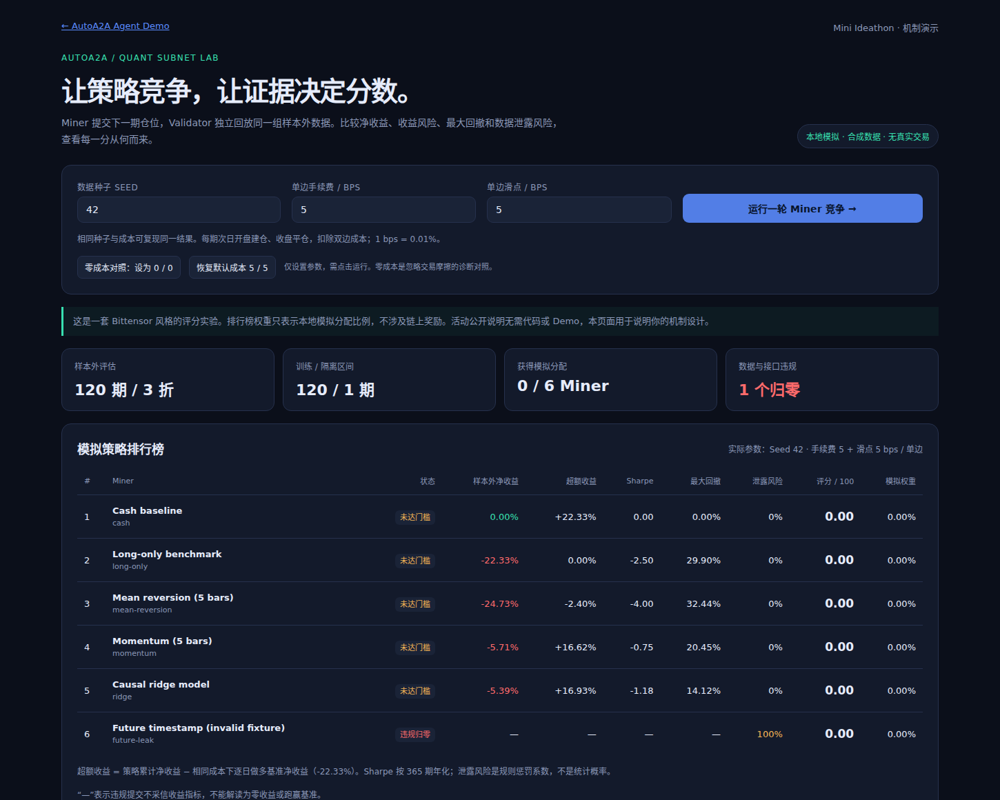

# AutoA2A Quant Subnet Lab：60分钟 Mini Ideathon 原型

目标：让不同 Miner 提交量化仓位信号，由 Validator 用同一条时间线、同一成交假设和同一套规则独立评分。用可检查的证据回答「谁值得获得模拟奖励」。

代码基于 `jack5190/MCP_A2A_DEMO` 主分支提交 `dcb8a39ef0ca1a949f5bbe1d49c0f992b3977683`。PR #2 于 2026-07-02 合并；本次复用现有 `@0xauto/mcp-server`、真实 MCP 内存传输、Next.js 和 A2A 消息记录方式。

## 1. 先跑起来

Node.js >=20.6（推荐22或24）；本次使用 Node.js 24.22.1 验证。需要安装依赖时联网，安装完成后评分和演示完全本地运行。无需模型 API Key、钱包、私钥、TAO、交易所账号或 Bittensor 节点。

```bash
npm ci
npm test
npm run typecheck
npm run lint
npm run build

# 命令行：真实 MCP 握手和工具调用，使用内存传输
npm run quant:demo

# 浏览器：启动后打开 http://localhost:3000/quant
npm run dev

# 同一数据，比较成本对结果的影响
npm run quant:demo -- --seed 42 --fee-bps 0 --slippage-bps 0
npm run quant:demo -- --seed 42 --fee-bps 5 --slippage-bps 5

# 纯 JSON，不含 npm 的命令标题
node --import tsx packages/mcp-server/src/quant-cli.ts --json > quant-result.json
```

页面支持设置种子和单边手续费/滑点、切换零成本对照、查看排行榜、净值曲线、三个顺序样本外区段、评分分量、违规原因及 A2A/MCP 调用记录。参数改变后需点击「运行」才产生新结果。



机器可读结果快照见 [quant-results.json](quant-results.json)。

### API

```bash
curl -s http://localhost:3000/api/quant \
  -H 'content-type: application/json' \
  -d '{"seed":42,"feeBps":5,"slippageBps":5}'
```

非法 JSON、越界/非数字参数和未知字段返回 400。此接口只运行内置策略，不能上传代码、指定外部交易接口或连接真实资金。

## 2. 已实现的模块

| 文件 | 作用 |
| --- | --- |
| `packages/mcp-server/src/quant/types.ts` | MinerTask、MinerSubmission、Miner、结果和指标契约 |
| `packages/mcp-server/src/quant/data.ts` | 固定种子合成 OHLC、时间切分、可见历史快照、数据 SHA-256 |
| `packages/mcp-server/src/quant/miners.ts` | ridge、动量、均值回归、每日做多、空仓、未来时间戳违规样本 |
| `packages/mcp-server/src/quant/validator.ts` | 净收益、Sharpe、最大回撤、提交审计、评分和模拟权重 |
| `packages/mcp-server/src/quant/tournament.ts` | 冻结规则、按时间逐期调用 Miner、立即保存提交快照、统一评估 |
| `packages/mcp-server/src/quant-tools.ts` | MCP 任务、预测预览和完整轮次评分工具 |
| `packages/mcp-server/src/quant-client.ts` | Coordinator → Miner → Validator 消息与 MCP 调用记录 |
| `packages/mcp-server/src/quant-cli.ts` | 无浏览器演示入口，支持完整 JSON 输出 |
| `apps/web/lib/quantExecutor.ts` | 复用现有 `connectDefiClient` 的 Web 编排 |
| `apps/web/app/api/quant/route.ts` | 有边界校验的本地 API |
| `apps/web/app/quant/page.tsx` | 中文排行榜、证据查看与成本对照 |

新增三个 MCP 工具：`quant_get_task`、`quant_miner_predict`、`quant_evaluate`。原有 `get_price` 仅提供模拟市场背景；它会推进原服务的模拟报价，但不会改变持仓。量化评分使用独立合成历史，不将该报价混入评估，也不调用 `swap_tokens` 或 `stake`。

`quant_get_task` 和 `quant_miner_predict` 展示首个任务及提交接口。`quant_evaluate` 在服务端重新构造完整可信任务并执行全部内置 Miner，不直接接受或计分预览结果。A2A 是本地角色编排，MCP 是真实协议调用；尚未实现远程多 Miner 网络。

## 3. Miner 任务契约

```ts
interface MinerTask {
  version: "quant-task-v1";
  taskId: string;
  asOf: number;                // 当前已知 bar 索引 t
  asOfTimestamp: string;
  history: Bar[];             // 只含 0..t，绝不含下一期结果
  horizon: 1;
  maxPosition: 1;             // -1..1，负数模拟做空
  maxTrainThrough: number;   // t-1：训练标签的最后可用索引
}

interface MinerSubmission {
  taskId: string;
  targetPosition: number;
  featureAsOf: number;
  trainedThrough: number;
  provenance?: string;
}

interface Miner {
  id: string;
  label: string;
  predict(task: MinerTask): MinerSubmission;
}
```

MCP 预览也检查 history 长度、索引顺序、时间先后、末尾时间与 asOf 一致性，以及训练隔离边界。Validator 会拒绝错 taskId、缺失/重复提交、未来特征、越界训练标签、NaN/Infinity 和超出 [-1,1] 的仓位。

添加自己的可信本地策略，不需要网络或改 UI：

```ts
import { runTournament, type Miner } from "./packages/mcp-server/src/quant/index.js";

const conservative: Miner = {
  id: "conservative",
  label: "Small fixed exposure",
  predict(task) {
    return {
      taskId: task.taskId, targetPosition: 0.2,
      featureAsOf: task.asOf, trainedThrough: task.maxTrainThrough,
      provenance: "fixed-exposure-v1; no fitted parameters",
    };
  },
};
console.log(runTournament({ seed: 42 }, [conservative]));
```

示例只是扩展接口，不是推荐交易策略。若需要 MCP/UI 展示新增策略，再将其加入 `MINER_IDS` 与 `builtInMiners()`。不要把陌生人的代码加载到同一进程；当前实现只适合本地可信代码。

## 4. 时间、费用和样本外定义

- 合成数据共 **241 根日 K 线**：初始训练 120 根、隔离 1 根、样本外 120 根。
- 第一笔样本外交易使用第 121 根的开收盘；其信号在第 120 根收盘后产生，训练标签截至第 119 根。索引从 0 开始。
- 每次只向 Miner 提供截至 t 的历史，标签最多用到 t-1；仓位在 t+1 开盘建立、t+1 收盘全部平仓。
- ridge 只使用此前已观察到的最多 80 对样本，固定正则化和仓位缩放，滚动重拟合。动量/均值回归使用最近 5 根历史收益。
- 这是逐期预测、逐期揭晓的 **prequential / walk-forward** 评估。较早的 OOS 结果在后来已经成为历史时可以用于训练；不存在始终封存的最终隐藏测试集。
- OOS 分成 3 个连续 40 日区段用于汇总，不称为三个统计独立的交叉验证样本。
- 超参数与评分政策预先固定；所有 Miner 使用相同数据、费用和时间边界。

对权重 w、下一期开盘 O 和收盘 C，单期收益为：

```text
r = w × (C/O - 1) - 2 × (feeBps + slippageBps) / 10000 × |w|
```

默认单边手续费 5 bps、滑点 5 bps，因此满仓每日往返成本为 20 bps（0.20%）。收益按 `equity *= 1 + r` 复利。每期仓位相对于该期初权益；双边费用使用相同入场名义金额的简化模型。

最大回撤从初始权益 1 开始计算，首期亏损也计入。Sharpe 使用完整 120 期日收益的均值和样本标准差，按合成加密日频 365 期年化，假定无风险收益为 0；零方差返回 0，不产生无限高分。基准是同样逐日开仓/平仓的 long-only 策略，**不是买入持有**。

## 5. Validator 评分函数

这是本原型的 `ideathon-score-v1`，不是活动评审标准，也不是 Bittensor 或 SN80 的通用公式。

令 `clip(x)=max(0,min(1,x))`：

| 分量 | 计算 | 权重 |
| --- | --- | ---: |
| 超额收益 E | clip((策略 OOS 累计净收益 − 同成本做多基准净收益) / 10%) | 35% |
| 风险调整 S | clip(Sharpe / 2) | 35% |
| 回撤 D | clip(1 − 最大回撤 / 30%) | 20% |
| 稳定性 C | 三个 OOS 区段中净收益为正的比例 | 10% |

`score = 100 × (0.35E + 0.35S + 0.20D + 0.10C) × (1 − leakageRisk)`

先检查资格：净收益必须 >0、Sharpe 必须 >0、至少 10 期非零仓位，且不存在硬性提交违规。否则分数为 0。缺少来源说明将 leakageRisk 设为 0.40；硬性违规设为 1 并取消资格。

`leakageRisk` 是规则惩罚系数，不是概率。值为 0 只意味着未触发当前检查，不能证明训练数据绝对干净。违规样本的收益不予采信，页面显示「—」，不会宣称发现了一个高收益作弊策略。

合格分数归一化为 `rewardWeight = score / sum(scores)`；总分为 0 则全部权重为 0，不平均发奖。相同分数按资格状态及 Miner ID 稳定排序；并列的 0 分名次不代表投资能力高低。

30% 是**回撤分归零阈值**，不是自动止损或总分硬性淘汰线。当前公式也不要求正 alpha 才能拿分，盈利 long-only 可能获得模拟奖励。这是应在 Ideathon 讨论的机制选择。

## 6. 已复现结果与两分钟演示

默认 seed=42；数据 SHA-256：`6f6b9ddb20ced011070a84d57fe6b194c4bd87cbcd3165e272ba02f34b7dea81`。

| Miner | 默认费用 5/5 的 OOS 净收益 | 零成本 0/0 的 OOS 净收益 | 零成本分数 |
| --- | ---: | ---: | ---: |
| Momentum | -5.71% | +11.10% | 80.29 |
| Ridge | -5.39% | +3.44% | 49.94 |
| 每日做多 | -22.33% | -1.23% | 0 |
| 均值回归 | -24.73% | -11.28% | 0 |
| Cash | 0.00% | 0.00% | 0 |
| Future timestamp fixture | 违规，不采信收益 | 违规，不采信收益 | 0 |

默认全部分数和奖励权重为 0。保留同一个 seed 后去掉成本，动量和 ridge 才出现正收益。这说明成本假设会改变激励结果，不能把回测毛收益当作有效贡献。零成本情景仅用于诊断，不是现实成交承诺。

演示顺序：

1. 打开 `/quant`，用默认参数运行；说明「没有达到门槛就没有奖励」。
2. 查看 ridge 的净值、区段统计与审计原因。
3. 选择未来时间戳样本，解释它只是故意不合规的提交，不是获得未来价格的真实神谕。
4. 同一种子设置成本 0/0 并运行；观察正分数，再恢复 5/5。
5. 展开 MCP 调用与 Validator 评分分量；用证据解释变化。

## 7. 测试范围

`npm test` 包含原有 5 个 DeFi 测试、16 个量化核心测试、3 个 MCP 集成测试，共 24 个测试用例。某些 Node 测试报告器会按文件展示 3 项汇总；可分别直接运行测试文件查看逐用例结果。

关键覆盖：固定种子复现、费用双边计入、复利、首期损失回撤、样本 Sharpe、零方差、改变未来数据不改变当前任务/预测、错误时间和仓位、来源惩罚、缺失/重复提交、零奖励、权重归一化、任务修改隔离、Miner 异常、真实 MCP 连接、拒绝未来 history 与非法参数、持仓和质押余额不变。

额外回归测试：Miner 可能保留旧返回对象，后来看到结果再改旧仓位。runner 现在每次提交后立即复制快照，防止这种事后改写。这里是进程内快照，不是密码学 commit-reveal。

交付前还验证了生产构建、TypeScript、lint、本地 HTTP API，以及隔离 Chromium 中的默认场景、零成本切换、违规样本不显示收益图表、非法请求400、390px移动布局无页面横向溢出；未发现浏览器运行时异常。

## 8. 活动规则核查（2026-10-31，上海/新加坡 UTC+8）

已匹配活动：[Bittensor Unitour @SJTU：当 AI 遇上量化，一起来 Build！](https://luma.com/hackquest-e3ip)。

| 公开页面已确认 | 内容 |
| --- | --- |
| 时间地点 | 2026-10-31 14:00 开始签到，上海交大闵行校区电群4号楼E谷一楼悟课剧场 |
| 活动时长 | 约3小时；Mini Ideathon 为60分钟，现场组队 |
| 必答设计 | 解决什么问题、Miner 做什么、Validator 怎么评、机制如何持续有效 |
| 交付定位 | 创意展示，明确无需写代码或开发 Demo |
| 奖励 | 总奖池800元；前三名500、200、100元 |
| 范围 | 技术交流、学术探索、创意设计，不涉及真实交易 |

该公开页面未说明：队伍人数、评审权重、路演时间/模板、提交渠道/截止时点、既有代码与 AI 辅助是否允许、开源/IP条件、校外入校流程、费用与报名截止。应现场确认，不能说主办方在所有渠道都未公布。

尤其不要把「代码必交、购买TAO、部署测试网、GitHub提交」当作已经确认的要求。准备好本原型用于说明，但现场先确认提前代码的使用规则。

## 9. 60分钟工作分配（建议，不是官方议程）

| 分钟 | 输出 |
| --- | --- |
| 0–5 | 确认队伍/展示限制，确定一句话问题：难以区分有效信号与回测幻觉 |
| 5–15 | 画清输入/输出、Miner 可见数据、用户是谁；运行默认演示 |
| 15–30 | 讨论评分、费用、回撤和泄露；检查零奖励和违规样本 |
| 30–40 | 设计持续运行：轮次冻结、滚动隐藏数据、重复计算、申诉与规则版本 |
| 40–50 | 一页提案：问题、任务、评分、激励、谁会为可信评估付费 |
| 50–60 | 两分钟讲解排练；确认交付方式；仅按现场要求提交 |

### 可直接口述的提案

我们设计的子网生产可比较、可追溯的量化信号。Miner 在统一时间边界内提交下一期仓位，Validator 独立计算扣除成本的样本外收益、风险与最大回撤，并检查数据泄露。我们复用了 AutoA2A 的 MCP 和 Agent 编排，已经有一个可运行的本地评分演示。演示中，同样的策略在零成本时盈利、计入成本后却全部失去奖励资格；违规提交也无法获得分数。下一阶段的核心是冻结提交物、采用无法提前获知的评估数据、多 Validator 复算，以及抑制复制策略和刷身份。我们希望服务需要可信策略比较的研究团队，并先验证他们是否愿意为评估服务付费。

## 10. 与 Bittensor / OpenRoboto 的对应和边界

[Bittensor 官方角色说明](https://www.bittensor.com/docs)：Miner 生产成果，Validator 评分，子网设计激励。本原型对应这三项分工。

[OpenRoboto 官方协议](https://github.com/openroboto-ai/openroboto-cli/blob/main/docs/SUBNET_OVERVIEW.md)说明 SN80 面向机器人学习，Miner 提交模型 checkpoint，统一模拟评测后生成排名。这里借鉴「固定提交物、统一条件、可复现证据」，没有复制其机器人奖励函数，也不把 SN80 称作交易子网。

[Yuma Consensus 官方说明](https://www.bittensor.com/docs/internals/consensus)涉及多个 Validator、质押与共识机制。本地单 Validator 的分数归一化不等同于 Yuma，代码没有注册子网、节点网络、钱包、质押、链上权重提交或代币分发。

当前核心限制：公共种子可被重建；自报时间/来源无法证明无污染；同进程执行不能约束恶意外部代码；120个合成样本不足以证明交易能力；仓位复制/多身份会稀释奖励；极小正仓位可利用 Sharpe 的规模性质。真实竞争应优先补充隔离执行、冻结模型与信号、私有且轮换的前瞻数据、截止时间/失败处理、多评估者复算、重复策略约束与争议处理。实际客户收入和运行成本需要验证，TAO 激励本身不是商业可持续性的证明。
